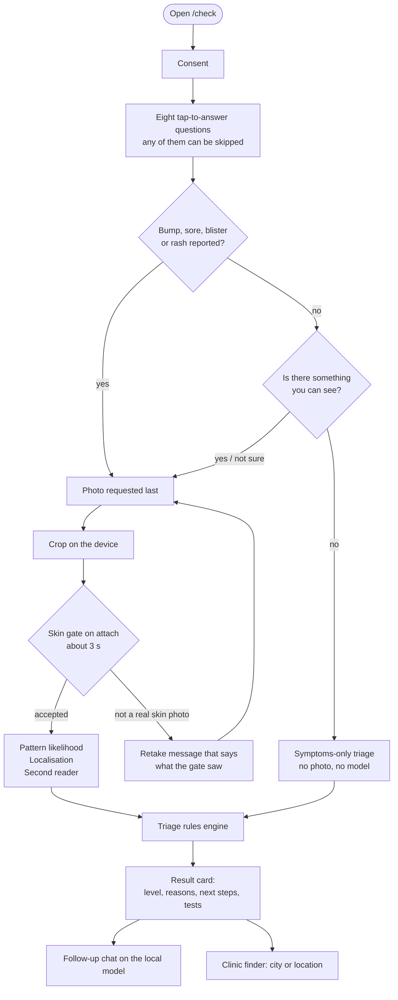
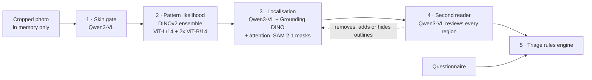
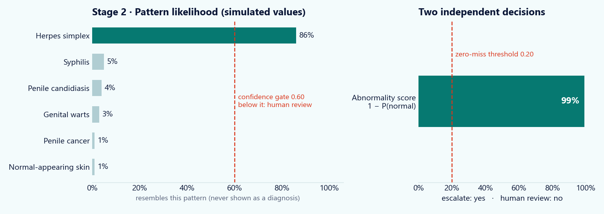
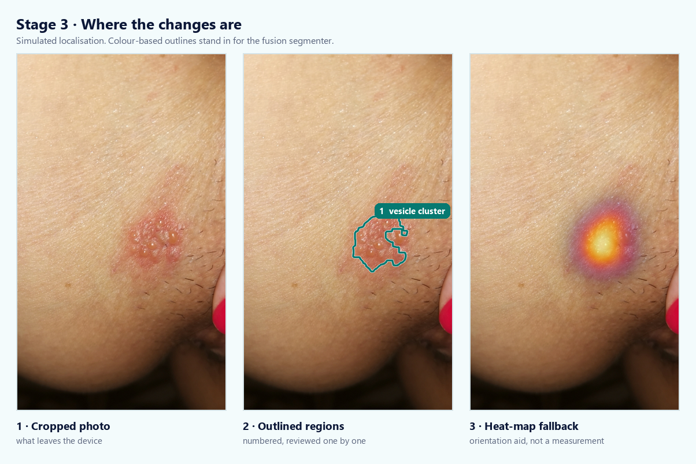
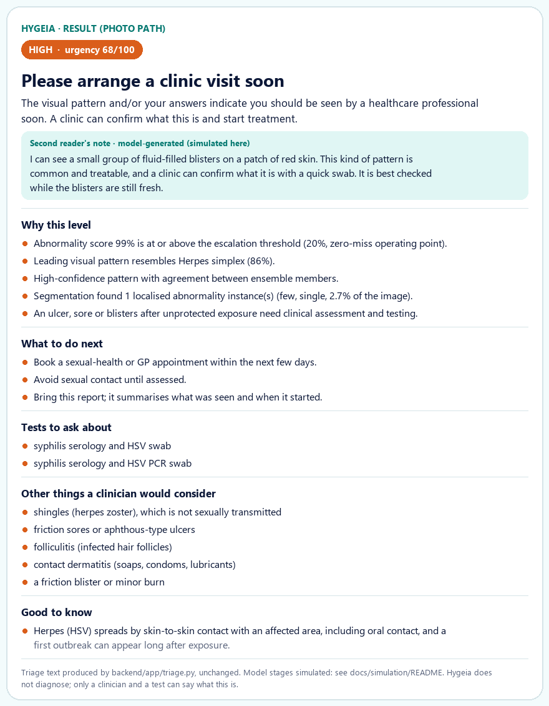
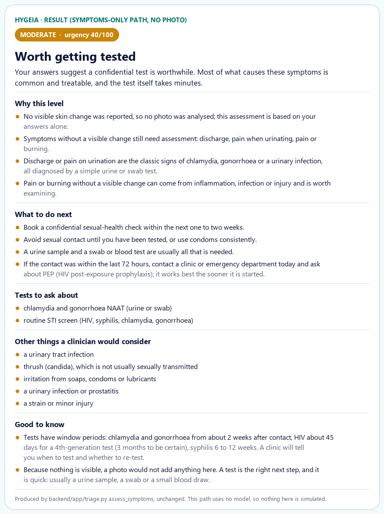

# Hygeia

**The hardest part is saying it out loud. Say it here first.**

Hygeia is a private, chat-first triage app for people worried about a sexually transmitted
infection. It asks a few questions, looks at a photo only when there is something to see, and
answers with how urgent the situation is, why, what to ask for, and where the nearest
sexual-health clinic is. No account, no name, no stored photo.

> [!IMPORTANT]
> Hygeia does **not** diagnose. It is decision support under clinical validation. A category is
> only ever shown as "a pattern that resembles X", a low-confidence "normal" is never shown as
> reassurance, and a rejected photo is never reported as "nothing found".

| | |
|---|---|
| **Set up and run** | [`README_SETUP.md`](README_SETUP.md) |
| **Architecture, API, design decisions** | [`docs/README_APP.md`](docs/README_APP.md) |
| **Pipeline specification** | [`docs/Hygeia_Vision_AI_Pipeline_Technical_Documentation_v2.md`](docs/Hygeia_Vision_AI_Pipeline_Technical_Documentation_v2.md) |
| **Model-free walkthrough used on this page** | [`docs/simulation/`](docs/simulation/) |

---

## Contents

1. [What happens in a check](#1-what-happens-in-a-check)
2. [Walk through a conversation](#2-walk-through-a-conversation)
3. [Inside the photo analysis](#3-inside-the-photo-analysis)
4. [The result the person sees](#4-the-result-the-person-sees)
5. [When there is nothing to photograph](#5-when-there-is-nothing-to-photograph)
6. [How the level is decided](#6-how-the-level-is-decided)
7. [What has been measured](#7-what-has-been-measured)
8. [Run it](#8-run-it)
9. [Limits you should know about](#9-limits-you-should-know-about)

---

## 1. What happens in a check



Three things are worth noticing before reading further:

- **The photo comes last and is optional.** Many infections show nothing on the skin, so the
  chat can finish without one.
- **Only one step can stop the analysis:** the skin gate. Everything after it adds evidence.
- **Every path ends at a clinic**, not at a label.

---

## 2. Walk through a conversation

Open each step in order. Hygeia's wording is taken from the app
([`Chat.tsx`](frontend/src/pages/Chat.tsx), [`intake.ts`](frontend/src/lib/intake.ts)); the answers are an example case
(`case01` in [`docs/simulation/sim_inputs.json`](docs/simulation/sim_inputs.json)).

<details open>
<summary><b>Step 1 · Start privately</b></summary>

<br/>

> **Hygeia** &nbsp; Hi, I'm Hygeia. I'm here to help you work out how worried to be about a skin
> change, privately and without judgement.
>
> **Hygeia** &nbsp; Here's how it works: a few quick questions first, then a photo only if
> there's something to see. Four AI models tell you how urgent it looks, show you what they saw,
> and point you to a clinic near you.
>
> **Hygeia** &nbsp; Your photo is analysed in memory and never stored on our server, and nothing
> you say is attached to your name. Ready to begin?
>
> **You** &nbsp; `I understand, let's start`

No account is created and nothing identifying is asked at any point.

</details>

<details>
<summary><b>Step 2 · Eight questions, tap or skip</b></summary>

<br/>

| # | Hygeia asks | Example answer |
|---|---|---|
| 1 | What have you noticed? Tap everything that applies. | `Blisters` |
| 2 | How long has it been there? | `Under a week` |
| 3 | Is it painful, or has it been changing? | `It's painful` |
| 4 | Any sexual contact in the last few weeks? | `Yes, unprotected` |
| 5 | Does either of these apply to you? | `Neither` |
| 6 | What was your sex at birth? | `Prefer not to say` |
| 7 | And how old are you? Type a number, or skip. | *skipped* |
| 8 | Last one: anything else you'd like me to know? | "Small blisters appeared three days ago. They sting." |

Every question has **Skip**, and **Skip the rest** is always available. The progress bar reads
"Question N of 8".

</details>

<details>
<summary><b>Step 3 · Photo, cropped on the device</b></summary>

<br/>

Because a visible symptom (blisters) was reported, the photo is requested now.

Hygeia asks for a photo of the area and offers three buttons:

> **You** &nbsp; `Take a photo` &nbsp;·&nbsp; `Choose from gallery` &nbsp;·&nbsp; `Go by symptoms instead`

A full-screen crop sheet opens. Only the cropped file is uploaded, so faces and surroundings
never leave the phone. The skin gate runs the moment the photo is attached. If it is a
screenshot, a drawing or not skin, the chat says what it looked like and asks for a retake.

</details>

<details>
<summary><b>Step 4 · Analysis, shown live</b></summary>

<br/>

The chat shows the stages as they run:

```text
[done]     Checking the photo             Orientation and capture quality
[done]     Is it analysable?              Making sure this is a skin photo we can read
[done]     Pattern analysis               Comparing against six trained categories
[done]     Finding the areas of concern   Outlining visible changes on the photo
[running]  Second look                    An AI reader describes and cross-checks
[waiting]  Working out urgency            Putting the findings and your answers together
```

Section 3 shows what each stage produces.

</details>

<details>
<summary><b>Step 5 · Result, follow-up and clinic</b></summary>

<br/>

The result card (section 4) appears in the conversation, followed by:

> **You** &nbsp; `Find a clinic near me`
>
> *Hygeia asks for a city, or offers to use the device location.*
>
> **You** &nbsp; `Use my location`

A map search for sexual-health clinics opens, with a short note on what the visit involves.
Follow-up questions are answered by the local model, grounded on the stored result. The
result lives in server memory for six hours and is then discarded.

</details>

---

## 3. Inside the photo analysis



> [!NOTE]
> **About the figures below.** They come from
> [`docs/simulation/simulate.py`](docs/simulation/simulate.py), a model-free walkthrough.
> The triage text is produced by the real rules engine
> ([`backend/app/triage.py`](backend/app/triage.py), run unchanged). The model stages are
> **simulated**: the likelihood values are hand-written and the outline is drawn by a simple
> colour segmentation, not by the fusion segmenter. They show how a result is assembled and
> presented. They are not a recorded run of the models and say nothing about accuracy.

### Stage 2 · Pattern likelihood and the two thresholds



The classifier gives a likelihood for six visual patterns. Two numbers are then checked
independently:

- **Abnormality score** `1 − P(normal)` against the **zero-miss threshold (0.20)**. At or above
  it, the person is advised to be seen.
- **Top-pattern confidence** against the **confidence gate (0.60)**. Below it, the category is
  treated as uncertain and the case is marked for human review.

<details>
<summary>Sexual-health image: localisation figure (click to show)</summary>

<br/>

### Stage 3 · Where the changes are



- **Outlined regions** are numbered. The second reader reviews each one and can reject it.
- **Heat-map fallback.** If the second reader judges the outlines wrong and offers no
  replacement, the markup is hidden and a soft heat map is shown as an orientation aid.
  Triage then ignores the localisation.

</details>

### Stage 4 · Second reader

A local vision-language model describes what is visible, cross-checks the classifier, reviews
each outline and writes the plain-language note. It can say that what it sees is **outside the
six trained patterns** and name the closest look-alike. It never overrides the classifier and
cannot raise the level on its own.

---

## 4. The result the person sees

<details open>
<summary>Result card for the example case</summary>

<br/>



</details>

How this level was reached, straight from the rules engine:

| Evidence | Effect |
|---|---|
| Abnormality score above 0.20 | escalate, level **moderate** |
| Pattern confidence above 0.60 | auto-processed, no human-review flag |
| Blisters **and** unprotected contact reported | **+1 level → high** |
| Leading pattern in the herpes/syphilis group | swab and serology suggested |
| Look-alikes for the pattern and the symptoms | listed under "Other things a clinician would consider" |

The full payload for this case is in
[`docs/simulation/out/case01_payload.json`](docs/simulation/out/case01_payload.json).

---

## 5. When there is nothing to photograph

HIV, chlamydia, gonorrhoea and early infections usually show nothing on the skin. If the
person says nothing is visible, no photo is requested and the answer is driven by symptoms and
exposure alone.

<details>
<summary>Symptoms-only result (pain when urinating + discharge, unprotected contact)</summary>

<br/>



This card is not simulated at all. The symptoms-only path uses no model, so it is the exact
output of `triage.assess_symptoms` for that questionnaire.

</details>

You can get the same result from a running server:

```bash
curl -X POST http://127.0.0.1:8000/api/triage -H "Content-Type: application/json" -d '{"questionnaire":{"symptoms":["pain_urination","discharge"],"exposure":"unprotected"}}'
```

---

## 6. How the level is decided

The two thresholds are independent, so all four combinations exist and each has a defined
behaviour.

| Escalate | Review | Combination | What the person is told |
|:---:|:---:|---|---|
| no | no | `confidently_normal` | **Low.** Routine screening still recommended after an exposure. |
| yes | no | `confidently_abnormal` | **Moderate**, **high** for a syphilis-like pattern, **urgent** for a cancer-like pattern. |
| yes | yes | `abnormal_category_uncertain` | As above, plus "routed for human review; category uncertain". |
| no | yes | `normal_low_confidence` | **Moderate.** A low-confidence normal is not reassurance. |

Then the questionnaire and the other stages adjust it:

<details>
<summary>Modifiers</summary>

<br/>

| Signal | Effect |
|---|---|
| Ulcer, sore or blisters after unprotected contact | +1 level, syphilis serology and HSV swab suggested |
| Fever together with skin changes | +1 level |
| Bleeding, or a lesion lasting more than four weeks | +1 level |
| Discharge or pain when urinating | at least moderate, chlamydia/gonorrhoea NAAT suggested |
| A partner diagnosed with an STI | at least moderate, full screen suggested |
| Extensive findings (over 15% of the image, or 8+ regions) | +1 level on an escalated case |
| Second reader disagrees with the classifier | at least moderate, category marked uncertain |
| Appearance outside the six trained patterns | at least moderate, "possibly not an STI", look-alikes listed |
| No recent sexual contact | **level unchanged**; skin-to-skin transmission and non-STI look-alikes explained |

</details>

Four levels come out: **low**, **moderate**, **high**, **urgent**, each with its reasons,
actions and suggested tests.

---

## 7. What has been measured

The classifier and its two thresholds are the measured parts. All figures are on the
720-image held-out test split (120 per class), re-scored through the serving path
([`backend/results/serving_path_validation.json`](backend/results/serving_path_validation.json),
[`models/ensemble_summary.json`](models/ensemble_summary.json)).

| | Result |
|---|---|
| Six-way accuracy, deployed ensemble | **94.86%** (95% CI 93.0–96.2%) |
| Six-way macro-F1 / ROC-AUC | 0.9484 / 0.9954 |
| Zero-miss threshold 0.20 | **100% sensitivity**, 0 of 600 abnormal images missed, 86.7% specificity |
| Confidence gate 0.60 | 94.9% of images auto-processed at 97.1% accuracy |
| Serving transform vs training transform | tensor-identical (`tests/test_parity.py`) |

These are engineering results on curated data. They are not clinical performance.

---

## 8. Run it

Full instructions, requirements and troubleshooting are in [`README_SETUP.md`](README_SETUP.md).

```powershell
.\setup.ps1
```

```powershell
.\run.ps1
```

Then open <http://127.0.0.1:8000> for the landing site and <http://127.0.0.1:8000/check> for
the chat. You need Python 3.11, an NVIDIA GPU with 6 GB or more, and about 25 GB of disk; setup
downloads the open-source models (about 10 GB).

To regenerate the figures on this page without any model or GPU:

```bash
python docs/simulation/simulate.py path/to/photo.jpg --name case01
```

It needs only `numpy`, `opencv-python`, `pillow` and `matplotlib`. See
[`docs/simulation/README.md`](docs/simulation/README.md).

| Route | What it is |
|---|---|
| `/` | landing site |
| `/check` | the patient chat |
| `/result/:id` | full report: likelihood, regions, second reader, triage reasons |
| `/history` | results kept in this browser only |
| `/models`, `/advanced` | clinician pages: model card, runtime status, analysis settings |

---

## 9. Limits you should know about

- **No clinical validation yet.** The system must sit inside a clinically governed pathway with
  human review of flagged cases.
- **The skin gate and the localiser are substitutes** for the trained models described in the
  specification. They are verified on small batteries and end to end, with no measured accuracy
  on a large set.
- **Herpes is the weakest pattern** (F1 about 0.89). Most errors are confusions between
  ulcerative and inflammatory patterns, which all route to assessment.
- **The second reader can be wrong.** Its text is labelled model-generated and is advisory.
- **No fairness analysis** by skin tone, device or age has been done; the dataset carries no
  such metadata.
- **The clinic finder opens a Google Maps search**, so the city or location typed there is sent
  to Google. The photo and the conversation are not.

---

<sub>Hygeia · DATANOVA 2026 Global Data-thon, Healthcare & Social Impact · Guide one. Protect many.</sub>
